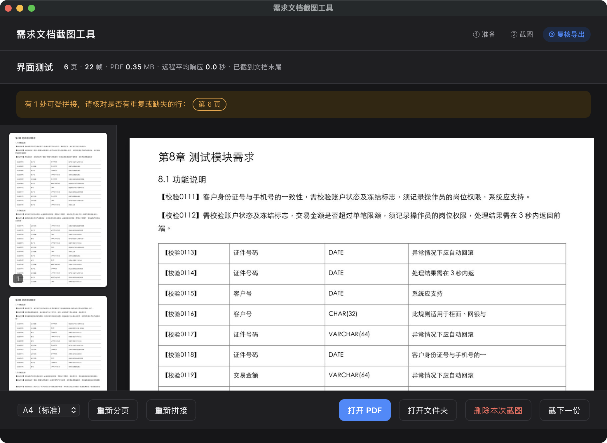

# 需求文档截图工具

在 Mac 上把**远程桌面 / 浏览器里的超长文档**自动滚动、截图、拼接，生成**可搜索的 PDF**。

适合"文档只能在线看、不能下载，只能一页页截图"的场景：框选一次区域，点开始，剩下的交给它。



## 功能

- **自动滚动 + 截图**：自动标定滚动距离，每次滚动后等画面完全稳定再截，不会截到半渲染的模糊画面
- **无缝拼接**：相邻截图保留重叠，按像素对齐拼接，不重复、不丢行；行距规整的表格、大段空白页都做了专门处理
- **远程桌面卡顿也能用**：画面没反应时边等边看，不会误判"到底了"；结束后报告远程响应速度并建议参数
- **可疑拼接自动标出**：少数无法百分百确认的拼接处会在复核页用红线标出，只需人工看这几处
- **可搜索 PDF**：用 macOS 自带的文字识别（离线），PDF 能 `⌘F` 搜索、能复制文字，另附 txt
- **智能 PDF 压缩**：默认原分辨率黑白化以保留小字，逐页 OCR 验收并让特殊页面自动回退灰度，超过大小上限时按文字大小分档降分辨率，实测 30 页 22 MB → 2 MB，兼顾体积、清晰度与可搜索性
- **支持全屏**：文档全屏打开、三指横扫切过去也能用

所有处理都在本机完成，**不联网、不上传任何内容**。

## 下载安装

到 [Releases](../../releases) 页面下载最新版本，**按你的 Mac 芯片选择**：

| 你的 Mac | 下载 |
|---|---|
| Apple 芯片（M1/M2/M3/M4…） | `需求文档截图工具-vX.Y.Z-AppleSilicon.zip` |
| Intel 芯片 | `需求文档截图工具-vX.Y.Z-Intel.zip` |

> 不确定？点屏幕左上角  →「关于本机」，看"芯片"或"处理器"一栏。

解压后把 `需求文档截图工具.app` 拖进「应用程序」文件夹。

### 第一次打开（必读）

本程序没有购买 Apple 开发者签名，第一次打开会被系统拦截，这是正常的：

1. 双击打开，系统提示"无法打开"或"无法验证开发者"，点「完成」/「取消」
2. 打开「系统设置 → 隐私与安全性」，拉到最下面，点「仍要打开」，再确认一次

如果提示"已损坏，无法打开"，在「终端」里执行下面这行后再打开：

```bash
xattr -dr com.apple.quarantine /Applications/需求文档截图工具.app
```

### 授予权限

程序首页会显示权限状态，点「去授权」按提示打开：

- **屏幕录制**（系统设置 → 隐私与安全性 → 屏幕与系统录音）：用于截图
- **辅助功能**（系统设置 → 隐私与安全性 → 辅助功能）：用于自动滚动页面

打开后需要**退出并重新打开**本程序才生效。

> **升级新版本后需要重新授权**：因为没有开发者签名，系统会把新版本当成另一个程序。在上面两个设置页里先用「−」删掉旧的「需求文档截图工具」，再重新授权即可。

## 使用方法

1. **打开要截的文档**。推荐全屏打开，并把文档缩放调到字看得清的程度——工具按屏幕显示的样子截，字太小截下来也看不清
2. 回到本程序，点「**框选区域**」：3 秒内切换到文档页面（全屏的话三指横扫过去），然后拖框选中**文档正文**
   - 只框正文，宁小勿大。**不要框进**地址栏、文档顶部固定的工具栏、侧边目录、悬浮按钮——它们不随页面滚动，会干扰拼接
   - 框选后不要再移动或缩放窗口
3. 选一下「**远程网速**」（不确定就选"一般"），点「**开始截图**」
4. 倒计时期间：切到文档页面 → 点一下文档正文 → 滚到最顶部 → **松开鼠标别再碰**
5. 截到文档末尾会自动停止；想提前停，**动一下鼠标**或点悬浮条上的「停止」
6. 在复核页检查标出的可疑页，点「打开 PDF」

结果保存在 `~/需求文档截图输出/<文档名>/`（特意不放在桌面/文稿，避免被 iCloud 同步）。用完可在复核页一键「删除本次截图」。

### 常用设置

| 设置 | 什么时候调 |
|---|---|
| 远程网速：流畅 / 一般 / 卡顿 | 截完后复核页会根据实测响应速度给出建议，可一键采用 |
| 高级设置 → 每次滚动幅度 | 拼接出错多时调小，如 0.4 |
| 高级设置 → 开始前倒计时 | 全屏切换来不及时调大，如 8 秒 |
| 分页大小 | 复核页可随时「重新分页」，不用重截 |
| 压缩为黑白 PDF / PDF 大小上限 | 要上传到有大小限制的系统时保持开启，按限制填上限；只想要彩色原图时关闭 |

## 常见问题

**截出来是黑的 / 提示截图失败**：没有屏幕录制权限，或授权后没有重启本程序。

**提示"滚动没有反应"**：没有辅助功能权限；或开始前没点击文档正文（窗口没获得焦点）；或文档已经在最底部。

**复核页提示"可疑拼接"**：点击跳到那一页，看红线上下有没有重复或缺失的行。大段空白后面接内容的地方常会被标出，多数情况下是正确的。也可以点「重新拼接」。

**OCR 有错字**：文字识别会认错个别字，txt 适合搜索；引用原文请以 PDF 里的图片为准。

## 从源码运行

需要 macOS 12+、Python 3.11+。

```bash
git clone <本仓库地址> && cd <仓库目录>
python3 -m venv .venv
.venv/bin/pip install -r requirements.txt
.venv/bin/python app.py
```

从终端运行时，权限要授予给「终端」（或你用的终端 App）。

也有命令行版：

```bash
.venv/bin/python doccap.py pick              # 选区域
.venv/bin/python doccap.py capture 文档名     # 截图并生成 PDF
.venv/bin/python doccap.py build 文档名 --restitch   # 用已截的图重新拼接/分页
```

## 开发

```bash
.venv/bin/pip install -r requirements-dev.txt
tests/run_sims.sh                      # 拼接算法回归：6 种远程卡顿/噪点场景（约 3 分钟）
.venv/bin/python tests/compact_check.py  # PDF 压缩：体积、搜索、超限处理（约 2 分钟）
.venv/bin/python tests/ui_e2e.py       # 界面端到端（真实窗口 + 模拟屏幕，约 30 秒）
./build.sh 0.1.0                       # 打包当前芯片架构的 .app 到 dist/
```

- `doccap.py`：引擎（截图、拼接、分页、OCR、PDF），也是命令行入口
- `app.py` + `ui/`：图形界面（pywebview）
- `tests/`：测试素材生成、模拟器与端到端测试

发布：推送 `v*` 标签（如 `git tag v0.1.0 && git push --tags`），GitHub Actions 会分别在 Apple 芯片和 Intel 机器上打包、自检，并发布到 Releases。

## 免责声明

本工具仅用于你**有权保存**其内容的文档。使用前请确认遵守所在单位、项目和合同的保密规定；因使用本工具产生的一切后果由使用者自行承担。

## 许可

[MIT](LICENSE)
